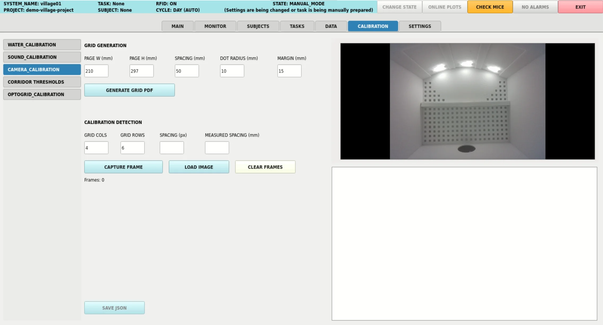

## Camera Calibration



The box camera uses a wide-angle lens, which distorts the image: straight lines look
curved, especially near the edges, and a centimetre does not cover the same number of
pixels in the centre of the image as in a corner. This panel measures that distortion
with a printed grid of dots laid on the floor of the box, so that the tracked positions
of the animal can be corrected and converted into millimetres on the floor. It also
measures how tilted the camera is with respect to the floor, which helps to align it.

Always available in the `CALIBRATION` screen. It calibrates the box camera; the
images of any other camera can be calibrated by loading them as files.

### How It Works

The grid is a sheet of black dots at a known, exact spacing, lying flat on the floor of
the box. The calibration compares where the dots really are (a perfect grid) with where
the camera sees them, and works out the lens model that explains the difference: the
camera matrix (focal length and optical centre) and the distortion coefficients. It
uses the standard OpenCV calibration (`calibrateCamera`), adapted to a grid of circles.
Since the grid lies on the floor, the same frame also gives the conversion from pixels
to millimetres on the floor, the px/cm scale across the floor and the alignment of the
camera.

A single frame is enough: it already contains every dot of the grid. The correction is
only reliable over the part of the floor that the grid covers, so the grid must cover
the whole surface you want to measure: one sheet for a small area, or several sheets
joined into a bigger grid for the whole floor.

Dots are used instead of the classic chessboard because the centre of a circle can be
located with sub-pixel precision even in a slightly blurred image. The white crosses
inside the dots and the grey lines between them are not used by the detection: they
help to measure the sheet with a ruler and to align several sheets.

### Panel Fields

The fields keep their values: each one is saved in a hidden setting
(`CAMERA_CALIBRATION_...`) as soon as it holds a valid value, so the panel opens with
the last values used.

**`GRID GENERATION`**: the printable grid.

| Field | Default | Description |
|---|---|---|
| `PAGE W (mm)` | 210 | Page width (A4). |
| `PAGE H (mm)` | 297 | Page height (A4). |
| `SPACING (mm)` | 50 | Centre-to-centre distance between dots. It is also the real spacing used to calibrate. |
| `DOT RADIUS (mm)` | 10 | Radius of each dot. |
| `MARGIN (mm)` | 15 | Empty border around the grid. With at least the dot radius all dots are complete; with `0` the dots on the edges are cut, to join several sheets. |

**`CALIBRATION DETECTION`**: the grid lying on the floor.

| Field | Default | Description |
|---|---|---|
| `GRID COLS` | 4 | Columns of dots to detect. Filled in when the PDF is generated. |
| `GRID ROWS` | 6 | Rows of dots to detect. Filled in when the PDF is generated. |
| `SPACING (px)` | blank | Expected spacing between dots in the image, in pixels. It restricts the detection to dots of that size; blank accepts dots of any usual size. |
| `MEASURED SPACING (mm)` | blank | Spacing measured on the printed sheet with a ruler. Used for the px/cm scale and the millimetres on the floor; blank uses `SPACING (mm)`. |

The fields are read on every capture, so they can be changed between captures.

### Preparing the Grid

1. Press `GENERATE GRID PDF`. The grid is saved as `calibration_grid.pdf` in the
   project's `data` folder, and `GRID COLS` and `GRID ROWS` are filled in with its size:
   4 x 6 dots with the default values.
2. Print it at 100% scale, not "fit to page", on matte paper (glossy paper can reflect
   the light and hide dots).
3. Check the spacing with a ruler. If it is not exactly the one requested, enter the real
   value in `MEASURED SPACING (mm)`: the millimetres on the floor depend on it. The lens
   distortion does not depend on the size of the grid.

If one sheet does not cover the surface you want to measure, build a bigger grid from
several sheets: set `MARGIN (mm)` to `0` before generating the PDF, so that the dots on
the left and bottom edges of each sheet are cut in half and are completed by the next
sheet when the sheets overlap. Use the grey lines to align them, tape them together and
enter the total number of dots of the assembled grid in `GRID COLS` and `GRID ROWS`.

### Capturing Frames

1. Lay the grid flat on the floor of the box, covering the surface you want to measure,
   with all its dots visible to the camera. Tape it down if it does not lie flat.
2. Press `CAPTURE FRAME`. The detected grid is drawn on the preview for 2 seconds, and
   then the preview goes back to the live image. The calibration runs in the background
   as soon as the grid is detected.
3. Optionally, capture a few more frames without moving anything: they average the
   noise of the image.

`LOAD IMAGE` uses an image file as a frame instead of the live camera, and
`CLEAR FRAMES` discards all the frames to start over. All the frames of a calibration
must have the same size. The frames are discarded when you leave the `CALIBRATION`
screen; save the result before leaving.

If you cannot build a grid as big as the surface, you can also move a single sheet
around the floor and capture it in each position: the lens correction then covers all
the positions together. It is less precise than a single grid covering everything, and
the floor coordinates are those of the last position captured.

If the grid is not detected:

- Check that `GRID COLS` and `GRID ROWS` match your grid, and that all its dots are
  visible and in focus.
- Leave `SPACING (px)` blank: a wrong value makes the detector reject the dots.
- Avoid reflections and strong shadows on the sheet.

```{admonition} Top of the image
:class: note
The panel shows and captures the image of the camera without the status bar that is
drawn at the top of it (and without any custom camera drawing), so the dots under it
are detected too. The video and the camera preview of the other screens keep the
status bar.
```

### Reading the Results

After each calibration the panel shows:

- **Calib reproj error**: the mean distance, in pixels, between the detected dots and
  where the calibrated model places them. Below 1 px is good. A high value usually means
  a badly detected grid, or a sheet that is not flat: clear the frames and capture again.
- **Distortion**: the type and strength of the radial distortion, from `k1`. Negative
  is barrel distortion (edges bulging outwards, typical of wide-angle lenses), positive
  is pincushion.
- **k1, k2, p1, p2**: the distortion coefficients. `k` are radial and `p` tangential
  (a lens not exactly parallel to the sensor); `p` are usually close to zero.
- **Principal pt offset**: how far the optical centre is from the centre of the image.
- **Floor scale**: how many pixels a centimetre of the floor covers, on average and its
  range across the grid.

**Camera alignment with the floor** shows the tilt (left/right and front/back) and the
roll of the camera with respect to the grid, with hints such as "raise right". The tilt
is rated `GOOD` below 2° and `OK` below 5°, and the roll `GOOD` below 1° and `OK` below
3°; anything else is `POOR`. The roll is measured along the rows of dots, so it only
means something if the grid is aligned with the walls of the box. To align the camera,
adjust it until the tilt is `GOOD`, then press `CLEAR FRAMES` and capture again: a
calibration is only valid for the position of the camera it was made with.

The four plots on the right show:

- **Residual error**: the reprojection error of every dot used. If it is concentrated
  in one area, the sheet may not lie flat there.
- **Lens distortion field**: how much, and in which direction, each part of the image
  moves when the distortion is corrected. The dashed line is the area covered by the
  grid, where the correction is reliable.
- **Tilt and roll**: the shape of the grid in the last frame (red) compared with the
  same grid seen straight on (green).
- **px/cm**: how many pixels a centimetre covers across the grid in the last frame.

### Result

`SAVE JSON` saves the result as `camera_calibration.json` in `data/<SYSTEM_NAME>/`,
next to the other calibrations of the system, replacing the previous one. Besides the
corrections, it records everything needed to understand the calibration later, even if
the panel's values change afterwards:

| Field | Description |
|---|---|
| `date`, `system_name`, `village_version` | When, on which system and with which version of Village it was made. |
| `camera_matrix` | `[[fx, 0, cx], [0, fy, cy], [0, 0, 1]]`, in pixels: focal lengths and optical centre. |
| `dist_coeffs` | `[k1, k2, p1, p2, k3]`: the distortion coefficients, in OpenCV order. |
| `reprojection_error_px` | The mean reprojection error, in pixels. |
| `image_size_wh` | Size of the calibrated frames. The calibration is only valid at this resolution. |
| `n_images_used` | Number of frames used. |
| `spacing_mm`, `measured_spacing_mm`, `spacing_px` | The grid and detector values (`null` when blank). |
| `tangential`, `principal_point_offset_px` | The size of the tangential distortion and the offset of the optical centre, as shown in the panel. |
| `alignment` | Tilt left/right, front/back and total, and roll of the camera with respect to the floor, in degrees. |
| `px_per_cm` | Mean, minimum and maximum pixels per centimetre of the floor. |
| `floor_homography` | 3 x 3 matrix that converts undistorted pixels into millimetres on the floor. |
| `floor_origin` | The floor coordinates: millimetres from the dot of the grid nearest the top-left corner of the image, with x along the rows of dots and y along the columns. |
| `calibrated_region_px` | Polygon, in pixels, of the area covered by the grid: the correction is only reliable inside it. |
| `frames` | Every frame used: its source (the box camera, with its resolution and lens position, or an image file), the grid size, the spacing and the number of dots found. |
| `description` | What each of these fields means. |

### Using the Calibration

The calibration is not applied automatically: the camera, the tracking and the videos
keep working with the original image. Use it in your own analyses, for example to
convert the positions of the animal saved in the CSV file of each video into
millimetres on the floor. The positions must come from a video recorded at the
resolution in `image_size_wh`, with the camera in the same position as when the
calibration was made.

```python
import json

import cv2
import numpy as np
import pandas as pd

with open("data/my_system/camera_calibration.json") as f:  # data/<SYSTEM_NAME>/
    calibration = json.load(f)
K = np.array(calibration["camera_matrix"])
dist = np.array(calibration["dist_coeffs"])
H = np.array(calibration["floor_homography"])

frames = pd.read_csv("video.csv", sep=";")
tracked = frames[(frames["x_position"] >= 0) & (frames["y_position"] >= 0)]
points = tracked[["x_position", "y_position"]].to_numpy(np.float32).reshape(-1, 1, 2)

# positions as they would be seen through a lens without distortion, in pixels
undistorted = cv2.undistortPoints(points, K, dist, P=K)
# positions on the floor, in mm (see floor_origin)
floor_mm = cv2.perspectiveTransform(undistorted, H).reshape(-1, 2)
```

Converting a point takes a few microseconds, so the same two lines can also be used
in real time, for example in a camera trigger, with `cam.x_position` and
`cam.y_position`. To correct whole images, use `cv2.undistort(image, K, dist)`.

---

Want to write your own calibration panel? See [Custom Calibrations](../advanced_customization/calibrations.md) and the [led_calibration.py](../examples/led_calibration.md) example.
