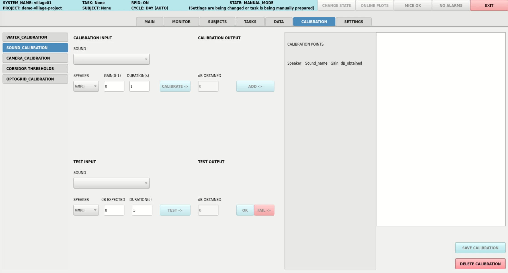

## Sound Calibration



Calibrates speaker output so a requested sound level in dB corresponds to an actual,
measured volume — per speaker (left/right) and per sound, so tasks can request a
sound in dB instead of a raw gain value.

Only available when `USE_SOUNDCARD` is **ON**.

The `SOUND` dropdown lists the functions in `sound_calibration_functions`, defined in
your project's `code/sound_functions.py`. Each function takes `gain` and `duration`
and returns a mono NumPy waveform array; see [sound_functions.py](../examples/sound_functions.md)
in the demo project for examples (`whitenoise`, `tone_600`, `tone_1000`...).

### Calibrating

Pick a sound and a speaker, enter a gain (0-1) and a duration in seconds, then click
`CALIBRATE` — the sound is played once through that speaker. Measure the resulting
volume with a sound level meter and enter it in dB, then click `ADD` to save the
point — it's added to the calibration curve, plotted immediately, and listed under
`CALIBRATION POINTS`, where each point can be removed individually with its `-`
button if it turns out to be an outlier. Repeat with a few different gain values per
speaker/sound pair (at least two points are required) to build a gain → dB curve.

Once you're happy with the curve, click `SAVE CALIBRATION` to persist it. Saved calibrations are never overwritten — every save gets
a new `calibration_number` and the full history is kept, but tasks and the testing
panel always use the most recent one per speaker/sound pair. `DELETE CALIBRATION`
discards the points collected so far (after confirmation) without saving them.

```{admonition} The curve must always go up
:class: warning
A higher gain must always give a higher level in dB. If a point breaks that trend (a
noisy measurement that gives fewer dB than a lower gain), the curve makes a bump
there, and a level in that range can be read on the wrong side of it. Check the plot
before saving, and remove such a point with its `-` button.
```

### Testing

Check whether the latest saved calibration for a speaker/sound pair is still accurate.
Pick the sound and speaker, enter a target dB and a duration, then click `TEST` — the
panel looks up the gain the calibration curve predicts for that dB. The sound is played at that gain;
measure the actual dB the same way as during calibration and enter it back — the panel
shows the resulting error and plots the test point against the existing curve.

- If the error is acceptable, click `OK`. The measurement is recorded for reference
  (it does not affect `get_sound_gain`, since it's stored with `calibration_number`
  -1) and the panel is cleared for another test.
- If the error is too large, click `FAIL` instead. The measurement is recorded the
  same way, but it's also used as the first point of a brand-new calibration for that
  speaker/sound pair, so you can immediately continue adding points to it (as in
  Calibrating above) and save a corrected curve.

### Using it in tasks

```python
gain = self.calibrations.sound_calibration.get_sound_gain(speaker, dB, sound_name)
```

Given a speaker (`0` = left, `1` = right), a target dB, and the sound's function name
(the name of the function in `sound_functions.py`, e.g. `"whitenoise"` or
`"tone_1000"`), this interpolates the gain from that speaker/sound pair's most recent saved
calibration curve. `dB=0` always returns a gain of `0.0` without needing a
calibration. Otherwise, if the pair hasn't been calibrated yet, or `dB` falls outside
the calibrated range, it raises a `ValueError` explaining the problem so it's easy to
tell whether the sound needs calibrating or the requested dB needs adjusting.

The example tasks of the demo project need two of them: `whitenoise` for both speakers
at 70 dB, and `tone_600` for speaker 0 (left) at 70 dB, the penalty tone of the last
two training stages (see [Task Examples (Bpod)](../examples/tasks_bpod.md)).

Data is stored in `sound_calibration.csv` (columns: `date`, `speaker`, `sound_name`,
`gain`, `dB_obtained`, `calibration_number`, `dB_expected`, `error(%)`).

---

Want to write your own calibration panel? See [Custom Calibrations](../advanced_customization/calibrations.md) and the [led_calibration.py](../examples/led_calibration.md) example.
